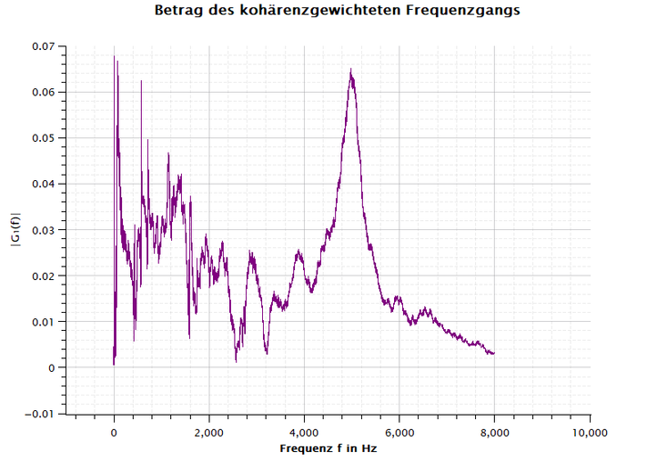
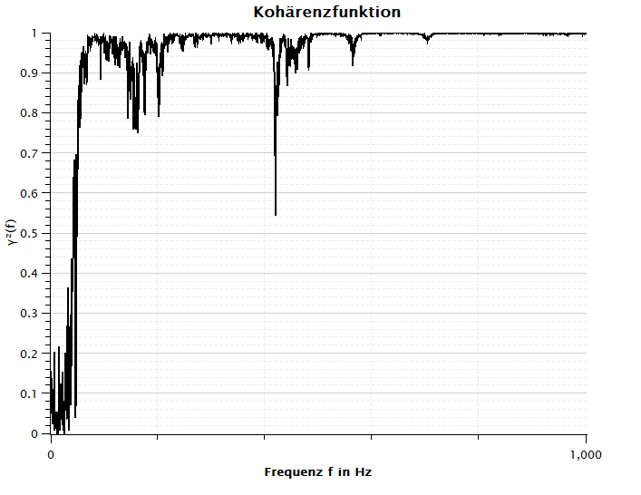
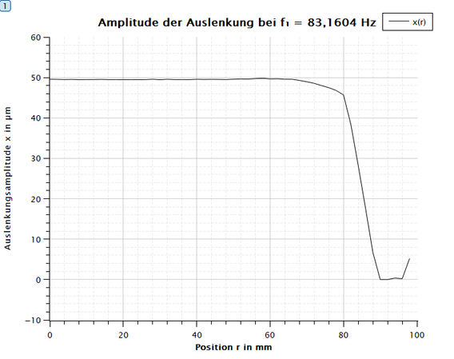
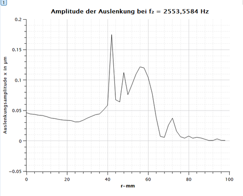
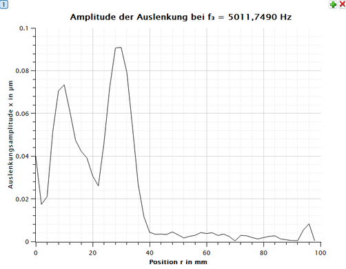
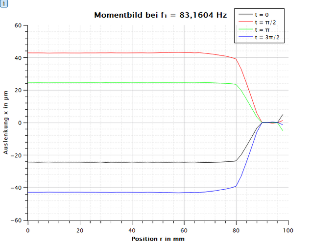
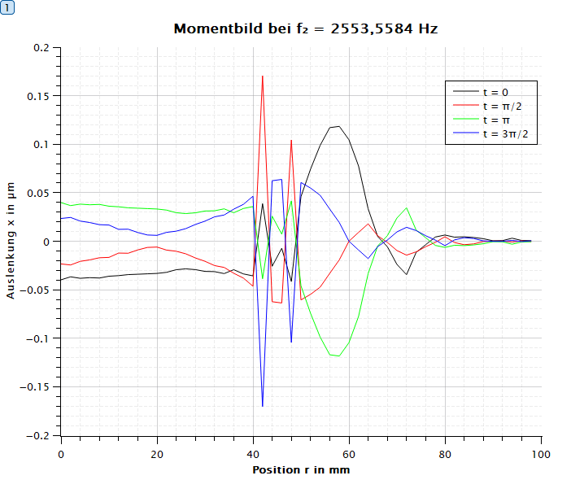
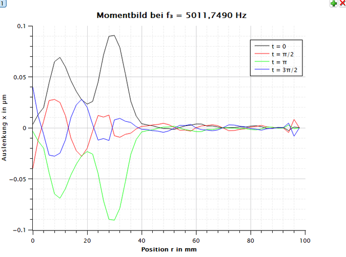

# Laser-Doppler Vibrometry: Loudspeaker Diaphragm Dynamics

**Experimental vibration measurement · Frequency-response analysis · Membrane vibration modes**

A sensor technology laboratory investigation of a loudspeaker diaphragm using a **laser-Doppler vibrometer (LDV)**. The experiment examines how diaphragm displacement, velocity and phase vary with excitation frequency and position across the membrane.

**Institution:** Hochschule München  
**Laboratory:** Sensorik  
**Experiment date:** 28 April 2026  
**Lab group:** Wassim Hamdi and Yosr El Mezzi  
**Report author:** Wassim Hamdi  
**Full documentation:** [Laboratory report (German, 15 pages)](report/Laser_Doppler_Vibrometry_Loudspeaker_Diaphragm.pdf)

## Objective

Investigate the transition from approximately piston-like diaphragm motion at low frequency to spatially varying vibration at higher frequencies. Frequency-response and coherence measurements provide the basis for selecting three operating points; radial LDV measurements are then used to compare diaphragm motion.

## Measurement method

1. Excite the loudspeaker with band-limited white noise for frequency-response measurement.
2. Measure the response and examine its coherence with the excitation.
3. Select three characteristic frequencies from the measured response.
4. Measure displacement and velocity profiles along the diaphragm, including phase information, with LDV.
5. Compare the radial profiles and instantaneous deflection shapes.

The detailed setup, figures, calculations and measurement tables are included in the linked report.

### Acquisition parameters

| Parameter | Reported value |
| --- | ---: |
| Sampling frequency, $f_s$ | 100,000 Hz |
| FFT record length, $N$ | 131,072 samples |
| Frequency resolution, $\Delta f=f_s/N$ | 0.76294 Hz |
| Excitation bandwidth | 20 Hz–8 kHz |
| Number of averages | 20 |
| Displacement calibration | 80 µm/V |
| Velocity calibration | 5 (mm/s)/V |

For the discrete Fourier transform, the frequency of bin $k$ is

$$f(k)=\frac{k f_s}{N}.$$

## Frequency-response measurements



*Frequency response from the laboratory report.*



*Coherence between excitation and response, as presented in the report.*

The three investigated frequencies were selected from characteristic features of the reported frequency response:

| Frequency | Identified feature | Diaphragm behavior |
| --- | --- | --- |
| **83.1604 Hz** | Local response maximum | Displacement is relatively uniform over much of the diaphragm, then decreases toward the edge. |
| **2553.5584 Hz** | Response minimum | Spatially uneven amplitudes and phase differences indicate partial vibration modes. |
| **5011.7490 Hz** | Higher-frequency response maximum | Stronger motion in the inner region, with substantially reduced displacement toward the outer region. |

The maximum/minimum classifications are those reported in the experiment; they are not a new independent frequency-sweep analysis.

## Radial displacement profiles

### 83.1604 Hz — approximately piston-like motion



The displacement amplitude remains comparatively steady through much of the measured profile before falling near the diaphragm edge.


### 2553.5584 Hz — nonuniform diaphragm motion



Multiple radial peaks and minima appear, consistent with more complex membrane deformation.


### 5011.7490 Hz — localized higher-frequency motion



The displacement profile is concentrated toward inner regions and decreases over much of the outer profile.


## Phase-dependent membrane deformation

The instantaneous profiles provide another view of the vibration patterns at the three frequencies.

| 83.1604 Hz | 2553.5584 Hz |
| --- | --- |
|  |  |



At higher frequencies, phase-dependent profiles show that different radial positions do not move in phase, consistent with partial vibration modes (*Partialschwingungen*).

## Displacement–velocity relationship

For a sinusoidal displacement of amplitude $\hat{x}$ at frequency $f$,

$$
 x(t)=\hat{x}\sin(2\pi f t),\qquad
 v(t)=2\pi f\hat{x}\cos(2\pi f t),\qquad
 \hat{v}=2\pi f\hat{x}.
$$

The report compares velocity calculated from the displacement amplitude with direct velocity measurements at the lowest selected frequency. The reported agreement is qualitative; no independent numerical uncertainty or error analysis is provided here.

## Repository contents

```text
README.md
report/
  Laser_Doppler_Vibrometry_Loudspeaker_Diaphragm.pdf
assets/
  figures/
    frequency_response.png
    coherence.png
    displacement_83hz.png
    displacement_2554hz.png
    displacement_5012hz.png
    instantaneous_83hz.png
    instantaneous_2554hz.png
    instantaneous_5012hz.png
```

The figures above are **unaltered measurement plots cropped from the PDF report** for readability. The repository contains the report and its extracted figures, not raw LDV acquisitions, measurement software, or source scripts. Numerical measurement tables are available in the report appendices (pages 13–15).

## Credits

**Report and technical analysis:** Wassim Hamdi  
**Laboratory group:** Wassim Hamdi and Yosr El Mezzi  
**Institution:** Hochschule München, Sensorik laboratory

This is an academic laboratory project, not a commercial measurement service or a validation of a production loudspeaker design.
